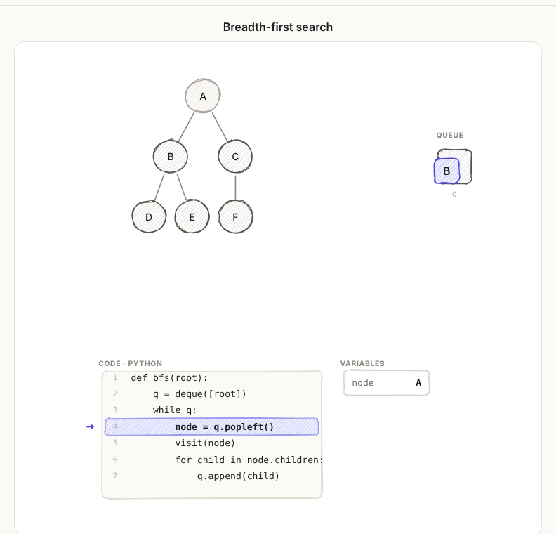
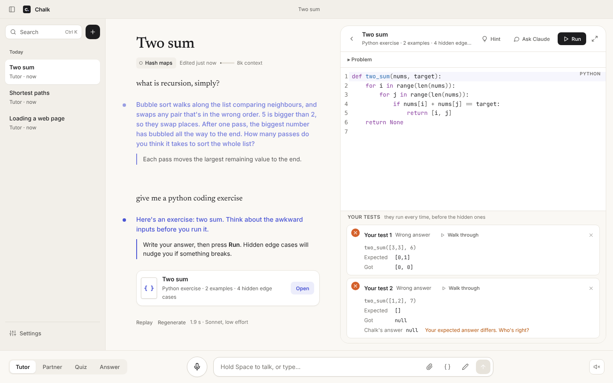
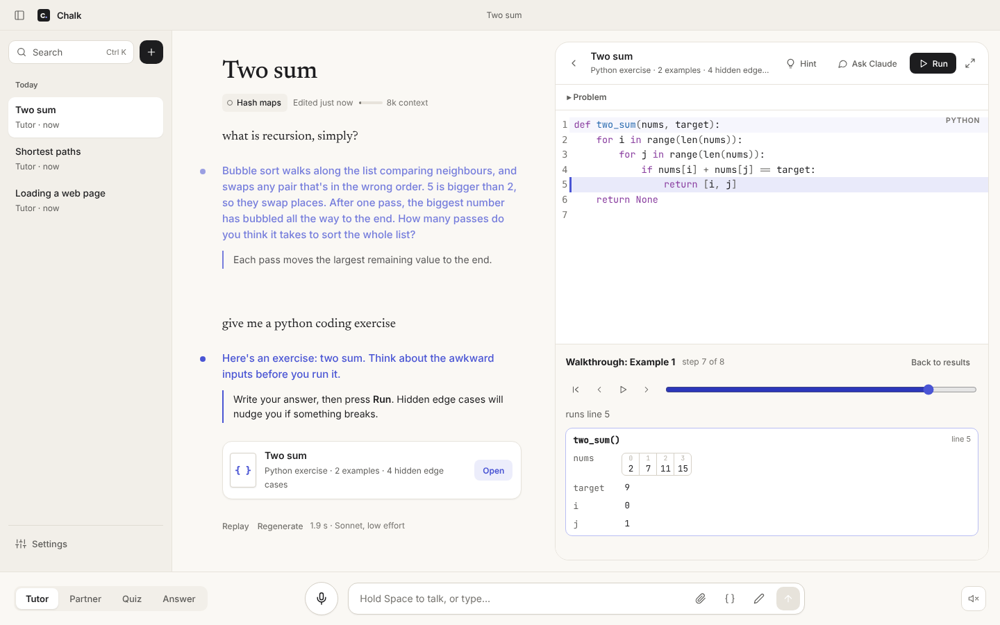
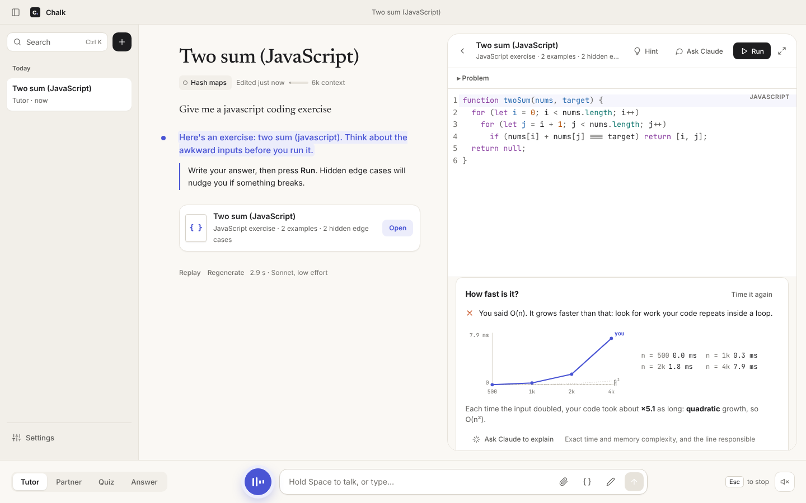
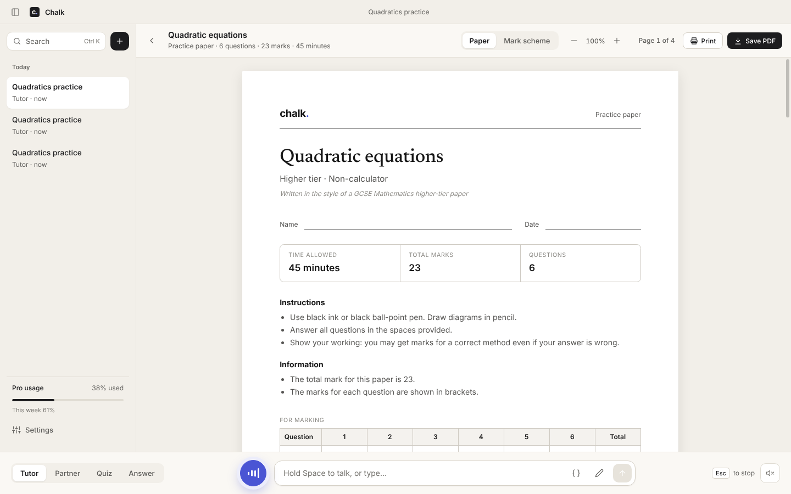

<p align="center">
  
</p>

<h1 align="center">Chalk</h1>

<p align="center"><em>Think out loud. Learn it one step at a time.</em></p>

<p align="center">
  A tutoring notebook for Windows that you mostly talk to. Say what you're stuck on and Claude explains it
  out loud, one step at a time, drawing on a canvas beside your notes. It runs on the Claude plan you
  already have, so there's no API key and no extra bill.
</p>

<p align="center">
  <a href="https://github.com/shrike99/chalk/releases/latest"></a>
  
  
  
</p>

<p align="center">
  <a href="https://github.com/shrike99/chalk/releases/latest">Download</a> ·
  <a href="#a-quick-tour">Tour</a> ·
  <a href="#things-to-try">Things to try</a> ·
  <a href="docs/USER_GUIDE.md">User guide</a> ·
  <a href="CHANGELOG.md">What's new</a>
</p>

<p align="center">
  
  <br>
  <sub>"How does breadth-first search work?" The tree, the queue and the code all move together as Claude talks.</sub>
</p>

---

## Why Chalk?

Most AI help gives you the answer. That feels great right up until the exam, when it turns out you
never did the thinking yourself.

Chalk tries not to let that happen. It explains things in small steps and stops partway through to ask
what you think comes next. When you're learning to code, it sets you an exercise and tests what you
write. It won't hand you the solution, even if you ask nicely (switch to *Just answer* mode if you
really do want it).

It also runs on your own computer as much as it can. Your notes stay on your PC, and with the optional
voice pack, speech recognition and Claude's voice both run on your own graphics card.

## A quick tour

### 1. Ask out loud, watch it get drawn

Hold <kbd>Space</kbd>, ask your question, let go. Claude answers out loud while the canvas builds the
explanation: graphs, arrays, trees, maths, or your own code with the current line lit up. You can pause,
rewind and replay any step, or click part of a diagram to ask about just that bit.

Every so often Claude stops and asks you to predict what happens next. Answer before it carries on.
That's most of the learning.

### 2. Practise, but write your own tests first

Say "give me a Python exercise" and one opens next to your notes. Chalk keeps a few hidden edge cases
back, and before it hints at any of them it asks you to come up with tricky inputs yourself.

<p align="center">
  
</p>

Your tests run every time, before the hidden ones. Chalk also checks the answers you *expected* against
a reference solution, so if you write a test that's wrong, it tells you ("Your expected answer differs.
Who's right?"). Afterwards it shows which edge cases you thought of and which ones you missed.

Exercises work in Python, JavaScript, Java, C and SQL. The code runs on your PC with time limits, never
through Claude.

### 3. Step through your code when it breaks

Hit **Walk through** on any test and Chalk runs your code one line at a time, drawing every variable as
it changes: lists as numbered boxes, dicts as key → value. No Claude involved, so it costs no usage.
(Python only for now.)

<p align="center">
  
</p>

### 4. Find out how fast it really is

Once every test passes, Chalk asks you to guess your solution's time complexity, then times your code as
the input keeps doubling. Below, someone guessed O(n) for a nested loop. Each doubling took about five
times longer, which is quadratic, and Chalk says so. Ask Claude and it'll point at the line that costs
the most, without telling you how to fix it.

<p align="center">
  
</p>

If a faster approach exists, you get a bonus round to find it.

### 5. Revise with a proper paper

"Make me a 45-minute GCSE-style paper on quadratics." You get print-ready A4 pages with a cover sheet,
marks for each question and a separate mark scheme, and you can save it as a PDF. Attach a few past
papers and say "follow this format" to match a particular exam's layout. If one question isn't right,
ask Claude to change that one and leave the rest alone.

<p align="center">
  
</p>

The questions are always new. Claude writes them in the style of the exam you name and draws its own
graphs, geometry and circuit diagrams.

## Things to try

```text
"Explain recursion like I've never seen it before."
"Here's a photo of my homework. Where did I go wrong?"        (attach the photo)
"Give me a SQL exercise on joins."
"Make me a worksheet on vectors, with a mark scheme."
"Quiz me on the causes of the First World War."               (Quiz mode)
"I think Dijkstra's algorithm works with negative edges."     (Thinking partner mode)
```

Every note has a mode, picked from the bottom bar:

- **Tutor** teaches step by step and checks you're following.
- **Thinking partner** reasons it through with you instead of lecturing.
- **Quiz** asks the questions.
- **Just answer** skips the teaching when you only need the answer.

## Everything else

| | |
| --- | --- |
| **Talk over it** | Interrupt Claude just by speaking. Stop a reply, edit your message and resend it, or regenerate. |
| **Files** | Drop in PDFs, photos of your notes or screenshots. Claude sees every page. |
| **Draw back** | Sketch on Claude's diagram with the pencil and it's sent with your next message. |
| **Progress chips** | Claude tracks the key ideas in each note and marks them new, shaky or understood. |
| **Usage aware** | See your 5-hour and weekly limits and how heavy each note is. When a note gets long, carry on in a fresh one. Small jobs run on Haiku to save your limits. |
| **Keyboard first** | <kbd>Ctrl</kbd>+<kbd>K</kbd> searches notes and runs any command. The [user guide](docs/USER_GUIDE.md) lists the rest. |

## Install

1. Download **`Chalk-Setup-<version>.exe`** from the [latest release](https://github.com/shrike99/chalk/releases/latest)
   and run it. The installer isn't code-signed yet, so Windows SmartScreen will probably warn you. Click
   **More info → Run anyway**. Chalk installs for your user account only, so you don't need admin rights.
2. Give the first launch a couple of minutes. Chalk sets up its own private Python in
   `%LOCALAPPDATA%\Chalk`. You don't need Python installed, and it won't touch a copy you already have.
3. Sign in with Claude in the browser tab that opens.
4. Optionally, install the voice pack (about 3 GB) from the welcome screen. It adds speech recognition and
   a natural voice, and uses an NVIDIA GPU if you have one.

**You'll need** Windows 10 or 11 (64-bit) and a Claude Pro or Max subscription. An NVIDIA GPU helps a lot
with the voice pack. Java and C exercises need a compiler, which Chalk can download for you from
**Settings → Coding**.

Stuck? The [user guide](docs/USER_GUIDE.md#troubleshooting) has a troubleshooting section.

## Build it yourself

You need Windows 10/11, [Node.js 20+](https://nodejs.org) and Git. You don't need Python to build the
installer.

```powershell
git clone https://github.com/shrike99/chalk.git
cd chalk
.\scripts\build-windows.ps1
```

The installer ends up in `desktop\dist\Chalk-Setup-<version>.exe`. The script builds the interface,
downloads `uv` (the single-file Python manager Chalk uses on first launch) and packages everything with
electron-builder. Double-clicking `scripts\build-windows.bat` does the same thing.

Pushing a version tag (`git tag v2.0.0 && git push --tags`) gets GitHub Actions to build the installer and
attach it to a release; see [`release.yml`](.github/workflows/release.yml).

For a development setup, the project layout and the tests, read [docs/BUILDING.md](docs/BUILDING.md).
[docs/ARCHITECTURE.md](docs/ARCHITECTURE.md) explains how the pieces fit together.

## How it works

```
Electron shell ──► FastAPI backend (Python) ──► Claude Agent SDK ──► your Claude account
      │                    │
      │                    ├─ SQLite notes, uploads, practice papers
      │                    ├─ code runners: Python · JavaScript · Java · C · SQLite
      │                    └─ Whisper (speech in) · Kokoro (speech out)
      └─ TypeScript UI (Vite): notebook, animated canvas, exercise panel, paper viewer
```

Claude replies with a short script that drives the canvas animation, plus structured blocks for papers
and exercises. Chalk validates and repairs those blocks before it shows them to you. For exercises,
Claude also writes a reference solution you never see. Chalk runs it against Claude's tests first and
drops any test it fails, so you're never marked wrong because Claude got an expected answer wrong.

## Privacy

- Your notes, uploads and settings stay on your PC, in `%APPDATA%\Chalk`.
- What you say and type, plus any files you attach, goes to Claude so it can answer you. That's covered
  by your own Claude account's terms.
- With the voice pack installed, speech-to-text and text-to-speech run locally.
- Chalk ignores your Claude Code configuration (MCP servers, plugins, CLAUDE.md), so none of that gets
  sent along with your messages.

## Contributing

Issues and pull requests are welcome. Have a look at [CONTRIBUTING.md](CONTRIBUTING.md) first.

## License

[MIT](LICENSE). Chalk is an independent project and isn't affiliated with or endorsed by Anthropic.
"Claude" is a trademark of Anthropic. Bundled fonts and other third-party components are listed in
[THIRD_PARTY_NOTICES.md](THIRD_PARTY_NOTICES.md).
